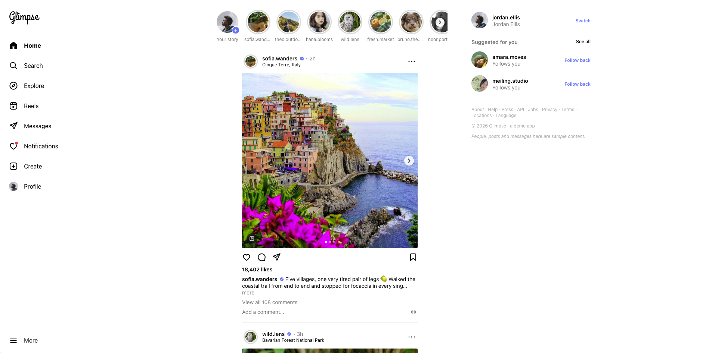

# Glimpse

A photo-sharing web app modelled closely on Instagram's web layout and interactions, built with **React 19 + TypeScript + Vite**. It runs entirely in the browser on mock data, behind an API layer designed to be swapped for a real backend.

> Glimpse uses its own name, logo and icon set. People, captions, comments and messages are sample content.

## Screenshot



## Run it

```bash
npm install
npm run dev        # http://localhost:5173
npm run build      # production build in dist/ (relative paths, deployable anywhere static)
npm run preview
```

## What works

| Area | Features |
| --- | --- |
| **Navigation** | Sidebar (Home, Search, Explore, Reels, Messages, Notifications, Create, Profile, More), unread badges, slide-out Search and Notifications panels, "More" menu (settings, saved, appearance, reset data) |
| **Feed** | Stories bar with seen/unseen rings, infinite scroll with skeletons, carousels, double-tap to like with heart burst, captions with "more", @mentions/#tags, inline comments with emoji picker, in-feed suggestions, "You're all caught up" |
| **Stories** | Full-screen viewer with progress bars, auto-advance, tap left/right, hold or Space to pause, keyboard arrows, neighbouring stories at the sides, like, reply by DM, add your own story from a file, profile highlights |
| **Posts** | Two-pane modal (prev/next through grids, arrow keys), comment/reply/like/delete comments, save, share to DMs, copy link, options sheet (delete, hide likes, turn off comments, unfollow) |
| **Create** | Drag-and-drop or file picker (or sample photos) → crop (1:1, 4:5, 16:9, original) → 12 filters + adjustments → caption, location, alt text, advanced settings → share |
| **Profiles** | Avatar with story ring, stats, bio, link, "Followed by", highlights, Posts / Reels / Saved / Tagged tabs, 3:4 grid with hover counts, follower/following lists, follow/unfollow with confirmation, Edit profile (photo upload) |
| **Explore & Reels** | Mosaic grid with tall tiles; vertical snap-scrolling reels with like/comment/share/save, pause, mute, double-tap |
| **Messages** | Inbox with notes, unread state, threads with grouped bubbles, timestamps, shared posts, double-click to heart, simulated typing and replies, new-message dialog |
| **Responsive** | ≥1264px full sidebar + right rail · 768–1263px icon rail · <768px top bar + bottom tabs, full-screen stories/reels/threads |
| **Theme** | Light and dark, following system preference; toggle in More → Switch appearance |

## Architecture

```
src/
  types/            Domain model (User, Post, Comment, Story, Conversation, …)
  data/seed.ts      Sample data + mediaManifest.ts (photo aspect ratios)
  services/
    api.ts          ApiClient interface — the only thing the UI talks to
    mutations.ts    Every write as a serialisable command + pure applyMutation()
    mockApi.ts      In-browser backend: localStorage persistence, latency, push events
    httpApi.ts      Reference REST + WebSocket client mapping each mutation to an endpoint
    storage.ts      Safe localStorage wrapper
  store/
    AppStore.tsx    React context: data, typed actions (optimistic updates), UI state
    selectors.ts    Feed, profile, explore, suggestions, search queries
  components/       layout, feed, post, stories, create, panels, profile, common, icons
  pages/            Home, Explore, Reels, Messages, Profile, Post, Notifications, Settings
  styles/           Plain CSS with design tokens (light/dark)
```

### Connecting a real backend

1. Implement the endpoints listed in `src/services/httpApi.ts` (e.g. `POST /posts/:id/like`, `POST /conversations/:id/messages`, `GET /me/bootstrap`).
2. In `src/services/api.ts`, replace `createMockApi()` with `createHttpApi(import.meta.env.VITE_API_URL, getToken)`.

The UI applies each mutation optimistically with the same `applyMutation` reducer the mock server uses, then calls `api.mutate()`; on failure it shows a toast and re-syncs from `bootstrap()`. Server pushes (new messages, typing, notifications) arrive through `api.subscribe()`.

Uploads are currently downscaled to JPEG data URLs; with a backend, upload the file first (e.g. to object storage) and put the returned URL in `MediaItem.src`.

## Media credits

Sample photos come from the [yavuzceliker/sample-images](https://github.com/yavuzceliker/sample-images) collection, which sources modified images from Pixabay under the Pixabay Content License. They were cropped and resized with `tools/posts.py` / `tools/avatars.py` into `public/media/`.